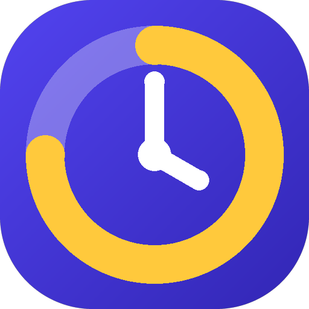

# Clockdown

Clockdown counts down to the things you don't want to miss, so you can stop checking the clock.

- **Countdowns for anything.** Create your own timers with a name, date, time, emoji and colour, and get an alarm before they start.
- **Your classes, automatically.** Connect your Amizone account once and your timetable shows up with live countdowns and alarms. You sign in on Amizone's own page. To make signing in again quicker, your ID and password can be kept encrypted on your phone (never sent anywhere except Amizone's own sign-in page), and you can delete them any time in Settings.
- **Attendance.** Your attendance from Amizone in its own tab: each subject's percentage in Amizone's own green, yellow and red, how many classes to attend to get back above 75% (or how many you can miss), which of today's classes have been marked, a recovery plan from your real timetable, and a leave planner. It stays on your phone, and it's refreshed when you open the app, pull down on the tab or tap the widget, with a little extra around class times.
- **Short alerts.** Class alerts play a two-second sound (five to choose from, all original: see [SOUNDS.md](SOUNDS.md)) and a quick buzz, then stop by themselves. Timers can optionally keep ringing until dismissed.
- **Home screen widgets.** A live ticking timer, your next classes, or a list of what's coming up, in your choice of looks: solid cards, gradients, bold, see-through glass and mono that adapt to your wallpaper, and more. Set one look for all class timers, or give each widget its own. After saving a timer, one tap puts it on your home screen.
- **Private by design.** No ads, no tracking. Everything stays on your phone. The only internet use is talking to Amizone and its LMS (if you connect it), once a day an anonymous version count (a random number the app made up and the version you're on, so the developer knows how many have updated), and, if the app crashes, sending a short crash report (the error and your phone model). None of it ever includes your ID, password, name or timetable. You can switch the version count and crash reports off in Settings.

## Install (Android 8 or newer)

Get Clockdown on Google Play: **[play.google.com/store/apps/details?id=com.rishabh.clockdown](https://play.google.com/store/apps/details?id=com.rishabh.clockdown)**. Open it and allow notifications when asked, so alarms can reach you.

**Updating:** updates come through the Play Store like any other app.

**Installed Clockdown from this page before?** Open Clockdown on Google Play (or **Settings → Check for updates** in the app) and tap **Update**. It's the same app, so your timetable, timers and sign-in stay as they are. Versions from this page stopped getting updates after 1.9.3.

**Staying signed in to Amizone:** Amizone's sign-in only lasts about 2½ hours unless it's used, so between 7 am and 11 pm Clockdown makes one tiny request roughly every 2 hours to keep it renewed. Overnight it does nothing; if Android delays it (battery savers) or the sign-in lapses, the one-tap reconnect still works.

## For developers

Build: `./gradlew assembleDebug` (needs JDK 21 and the Android SDK). Run the tests with `./gradlew testDebugUnitTest`.

Releasing (Google Play only; GitHub releases ended with 1.9.3, release `18`, which stays Latest so the old download link keeps sending people to Play):

1. In `app/build.gradle.kts`, raise `versionCode` above the last Play release (2.0 was 20, so next is 21) and set `versionName`.
2. Put your signing details in `local.properties` (`release.storeFile`, `release.storePassword`, `release.keyAlias`, `release.keyPassword`). That file is git-ignored. Then run `./gradlew bundlePlay`, which builds `app/build/outputs/bundle/play/app-play.aab`: the app without the GitHub self-updater and its install permissions (`app/src/play/AndroidManifest.xml`).
3. In Play Console, create a new Production release, upload the `.aab`, write what's new in plain words, and send it for review. Don't change anything in Play Console while it's in review.

Keep your signing key safe and backed up. Play signs with this same key (Play App Signing, uploaded with PEPK), and Android only installs an update signed with the same key as the version already on the phone. See `CLAUDE.md` for the checks to run before every release.
